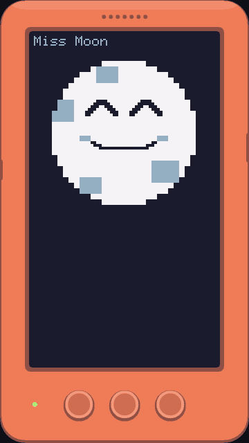
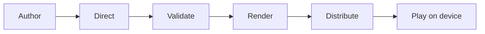
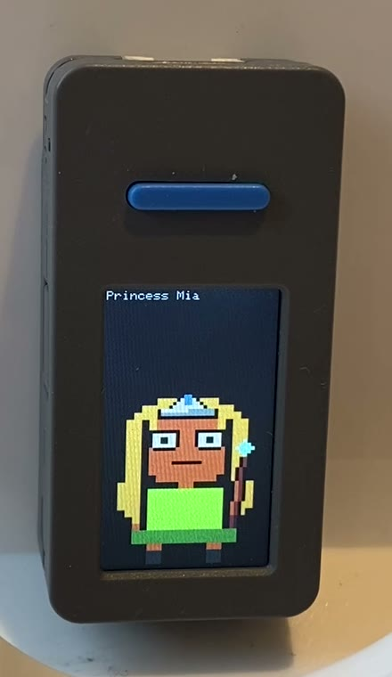
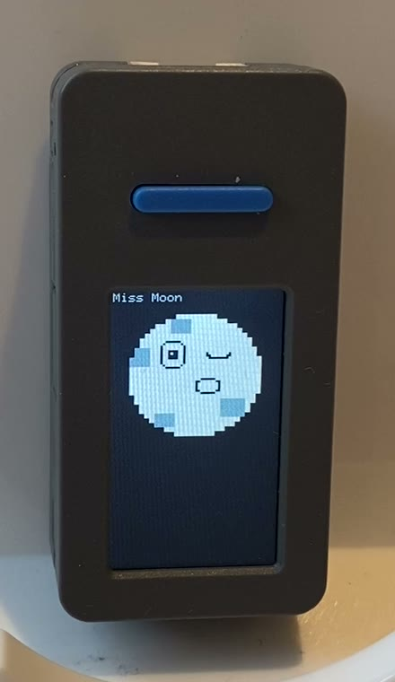

# Improv

[](https://github.com/jbulat/improv/actions/workflows/ci.yml)

<p align="center">
  
</p>

Improv is a pocket-sized improv troupe for children's stories. Hand it a story, and the same six pixel-art actors perform it. An AI casts the story and writes the stage directions, and a handheld device puts on the show, with a voice for every character and props and sound effects on cue.

Like a real improv troupe, the cast never changes. Bruno, Milo, Ada and Rosa are human; Pip and Tuk are animals. Between them they play every role in every story, dressed with props, with Miss Moon narrating. It's made for children of about five to ten, with their parents watching.

It's a working prototype, on real hardware and in a simulator. Claude Code skills do the AI work.

---

## Engineering

Serious engineering behind child's play:

- **AI output with guardrails and controls.** The AI casts onto a constrained vocabulary of actors, props and voices. A deterministic validator with no model inside rejects any story that breaks its rules. [See it reject a story](#3-validate), or read [`validator.ts`](tools/lib/validator.ts).
- **End to end, from firmware to AI pipeline.** C++ firmware on an ESP32-S3, with over-the-air story delivery checked file by file ([`StorySync.cpp`](device/lib/drivers/src/StorySync.cpp)); a Lua playback app on Inanimate's Resident runtime ([`player.lua`](device-apps/improv/src/player.lua)); a TypeScript toolchain that validates, builds and simulates stories ([`build-app.ts`](tools/build-app.ts)); and Claude Code skills as the AI stages ([`story-create`](.claude/skills/story-create/SKILL.md)).
- **Built with coding agents, verified by a person.** Designs approved before code, layered reviews, and hardware sessions that caught what the agents' reviews missed. [How I built this](#how-i-built-this).

---

## One story, from page to device

*The Knight and the Lonely Dragon*



The beat timeline is the contract between the AI and the device: Direct writes it, and the device reads it. It's defined by a JSON Schema, and everything on either side of it is swappable.

The casting rules work at two levels: the AI is told each rule and the reason for it, and plain code checks the result before anything is built.

### 1. Author

The original story brief:

> A dragon kidnaps a princess so a knight goes to save her. The knight discovers the dragon isn't mean, just lonely, they all become friends.

Every story must suit the youngest listener, a five-year-old at bedtime. An AI co-author applies this to the child's idea before writing, and steers rather than refuses: a monster that "eats everyone" gobbles every *hat* in town instead, and a fight to the death becomes a *dance-off*. This is a policy in the co-author skill; the validator doesn't check it.

### 2. Direct

The AI's first job is not to draw anything. It is to cast and script the story.

| Role | Actor | Dressed with | Voice |
|---|---|---|---|
| Sir Milo, the knight | `milo` | helmet, sword | `tts_mid_earnest` |
| Princess Rosa | `rosa` | tiara | `tts_bright_young` |
| the dragon | `tuk` | horns | `tts_low_rumble` |
| Host | `miss_moon` | nothing, ever | `tts_moon_host` |

Tuk is the troupe's big animal. A pair of horns makes him a dragon. Every actor, layer and voice in this table is an id from [`troupe/troupe.json`](troupe/troupe.json): it either exists or it doesn't, and that's what makes the AI's output checkable.

The cast becomes a beat timeline: who is on screen, how they feel, what they say, and which sounds land when. Two sentences in, fifteen beats out. Here is the confrontation, beats 5 to 11:

| beat | seconds | actor | role | text | expression | sfx | layers |
| --- | --- | --- | --- | --- | --- | --- | --- |
| 5 | 2.29 | tuk | the dragon | Who dares enter MY mountain? | angry | `sfx_roar@0.0s` | headwear=horns |
| 6 | 1.80 | rosa | Princess Rosa | Sir Milo! Help me, please! | scared |  | headwear=tiara |
| 7 | 2.26 | milo | Sir Milo | Stand back, dragon! | angry | `sfx_shing@0.3s` | headwear=helmet; front_prop=sword |
| 8 | 1.80 | tuk | the dragon | (breathes fire) | angry | `sfx_fire@0.0s` | headwear=horns; front_prop=fire |
| 9 | 1.91 | milo | Sir Milo | Wait — why are you so angry? | scared |  | headwear=helmet; front_prop=sword |
| 10 | 3.12 | tuk | the dragon | No one ever visits. I am always alone. | sad |  | headwear=horns |
| 11 | 2.63 | milo | Sir Milo | Then let's be friends. Come to our kingdom! | happy |  | headwear=helmet |

At beat 8, the dragon breathes fire, using `front_prop=fire`. At beat 11, Sir Milo puts his sword away.

<details>
<summary>All fifteen beats (the real output of <code>npm run export:story</code>)</summary>

| beat | seconds | actor | role | text | expression | sfx | layers |
| --- | --- | --- | --- | --- | --- | --- | --- |
| 0 | 3.55 | miss_moon | Miss Moon | In a green kingdom lived a brave knight named Sir Milo. | delighted |  |  |
| 1 | 4.03 | miss_moon | Miss Moon | One day a dragon carried Princess Rosa off to a dark mountain! | surprised | `sfx_whoosh@0.4s` |  |
| 2 | 1.90 | milo | Sir Milo | I will bring the princess home! | angry |  | headwear=helmet; front_prop=sword |
| 3 | 3.95 | miss_moon | Miss Moon | He traveled three days, over hills and rivers, to the mountain. | curious |  |  |
| 4 | 2.86 | miss_moon | Miss Moon | At the mouth of a cave, something was waiting… | curious |  |  |
| 5 | 2.29 | tuk | the dragon | Who dares enter MY mountain? | angry | `sfx_roar@0.0s` | headwear=horns |
| 6 | 1.80 | rosa | Princess Rosa | Sir Milo! Help me, please! | scared |  | headwear=tiara |
| 7 | 2.26 | milo | Sir Milo | Stand back, dragon! | angry | `sfx_shing@0.3s` | headwear=helmet; front_prop=sword |
| 8 | 1.80 | tuk | the dragon | (breathes fire) | angry | `sfx_fire@0.0s` | headwear=horns; front_prop=fire |
| 9 | 1.91 | milo | Sir Milo | Wait — why are you so angry? | scared |  | headwear=helmet; front_prop=sword |
| 10 | 3.12 | tuk | the dragon | No one ever visits. I am always alone. | sad |  | headwear=horns |
| 11 | 2.63 | milo | Sir Milo | Then let's be friends. Come to our kingdom! | happy |  | headwear=helmet |
| 12 | 1.98 | rosa | Princess Rosa | You're not so scary after all. | happy |  | headwear=tiara |
| 13 | 1.91 | tuk | the dragon | (a warm, rumbly laugh) | happy | `sfx_chime@0.9s` | headwear=horns |
| 14 | 3.45 | miss_moon | Miss Moon | So the dragon flew them home, and was never lonely again. | happy | `sfx_chime@0.0s` |  |

</details>

### 3. Validate

Before anything is built, plain code checks the whole performance:

```
$ npm run validate -- fixtures/knight-and-lonely-dragon/performance.json
✓ fixtures/knight-and-lonely-dragon/performance.json is a valid Performance (0 warning(s))
```

Break a rule and the build refuses:

```
ERROR   [ACTOR_DOUBLED] /cast/2/actor — actor "milo" already plays "hero" — one role per actor
ERROR   [LAYER_MISFIT] /cast/1/layers/headwear — layer "horns" fits [tuk], not actor "milo"

ERROR   [MISS_MOON_MISCAST] /cast/1 — miss_moon never plays a story role (got role "hero")
ERROR   [ACTOR_DOUBLED] /cast/1/actor — actor "miss_moon" already plays "miss_moon" — one role per actor
ERROR   [VOICE_NOT_SIGNATURE] /cast/1/voice — actor "miss_moon" always speaks with "tts_moon_host", got "tts_mid_earnest"
```

The last three lines come from one attempt to cast Miss Moon as a hero: three separate rules catch it.

The validator is **deterministic**: [25 rules](WORKFLOWS.md#the-validators-rules) of [plain code](tools/lib/validator.ts) with no AI model, so a story always gets the same verdict. Every failure is **explainable**, naming the rule, the field and the reason. 21 of its 23 error rules have a broken example in [`fixtures/invalid/`](fixtures/invalid/), and the build is a **guardrail** that refuses an invalid story.

While the pipeline is being developed, a person approves the beat table before anything is built. The everyday skill skips that step, never the validator.

### 4. Render, distribute, play

Every line becomes a voice clip in its actor's voice, and beat durations are measured from those clips, so pictures and narration agree by construction. The device fetches the audio over the local network and checks every file's size and CRC32 before the story goes live ([Workflows](WORKFLOWS.md#playing-it-on-the-device)). The simulator and the device run the same Lua file, and no model runs during playback.

https://github.com/user-attachments/assets/466f687b-ce5d-4780-8351-09a37805c2bd

<p align="center"><em>The whole story, 44 seconds with sound. Voices: <a href="https://huggingface.co/hexgrad/Kokoro-82M">Kokoro</a> (Apache 2.0).</em></p>

<p align="center">More stories, each from a child's idea: <a href="EXAMPLES.md"><strong>Examples</strong></a></p>

<p align="center">
  
  
</p>

---

## How I built this

I built this prototype between July and September 2026, with Claude Code as the main implementer. I specified the functionality, chose the tooling, and designed the interaction, the guardrails and the story pipeline. I managed the coding agents, did the manual testing, and ran every hardware session. Every decision was mine, or approved by me.

Every feature went through the same AI-assisted development loop, with three human verification points:

1. **A short design**, approved before any code.
2. **A test-first plan**, built task by task, with a layered review: the agent that wrote the code, a separate review agent that sent work back and asked me product and quality questions, then me on the pull request, mostly through the review comments and test coverage. Generating code moves the bottleneck to review, so the layers are arranged to spend my attention on product and quality questions rather than line-by-line reading.
3. **A hardware session** for anything the simulator can't prove.

The design and plan steps come from [Superpowers](https://github.com/obra/superpowers), a Claude Code plugin. I added the hardware sessions, two [story skills](.claude/) (a fast one for a child, a debug one for the pipeline) that are the Author and Direct stages, and the deterministic validator.

The clearest example is over-the-air delivery. A firmware bug passed the agents' code reviews, then surfaced in the first hardware session: the device's story sync never ran unless an app was already loaded. The simulator couldn't have caught it, because it implements the same protocol a second time. [The working documents for that feature](docs/process/ota-delivery/) are in the repo.

---

## What's built, and what isn't

- Proven on hardware: an M5 StickS3 (ESP32-S3, 1.14-inch screen) plays stories end to end, with pacing, layered sound effects, pause and resume, and restart.
- Eight stories, including an onboarding story where Miss Moon introduces the troupe.
- Delivery over the air: two full transfers, of 17 and 19 files, arrived byte-exact with no retries. Corrupted manifests and path-traversal attempts are rejected.
- A simulator that runs the same Lua file as the device and doubles as a headless test harness, inside a suite of 858 automated tests that includes the firmware's C++.
- Not built: the cloud pipeline, for which Claude Code skills and Kokoro, run locally, stand in.

What the prototype does *not* handle, such as authenticated delivery, is listed plainly in [Workflows](WORKFLOWS.md#known-limits-of-delivery).

---

## The documents

| Document | Read it for |
|---|---|
| [Examples](EXAMPLES.md) | Four more stories, each with the child's own words and a video. |
| [Getting started](GETTING-STARTED.md) | Install, generate audio, run the simulator. |
| [Workflows](WORKFLOWS.md) | Every tool, delivery, and known limits. |
| [Design decisions](DESIGN-DECISIONS.md) | Ten decisions, a paragraph each. Start here if you read one more thing. |
| [System design](improv-design.md) | Pipeline, data model, playback loop. |
| [The troupe](improv-troupe.md) | Actors, layers, casting rules. |
| [Storyboard](improv-storyboard.md) | The Knight cast two ways. |
| [How a feature was built](docs/process/ota-delivery/) | One feature's design and plan, with hardware results. |
| [Device surface](DEVICE-SKILL.md) | The StickS3's Lua modules. |

---

## Licence

The code and the art are under the [MIT licence](LICENSE). Some files carry other licences: see [third-party notices](THIRD_PARTY_NOTICES.md).

---

## About the author

I'm Jarrett Bulat, a hands-on engineering leader in London. Improv shows the kind of work I do for clients: building interfaces for AI products, taking a product from idea to working prototype as a technical lead, and bringing AI-assisted development into an existing delivery process, with clear points where people verify what the AI produces. If that's useful to your team, [find me on LinkedIn](https://www.linkedin.com/in/jarrettbulat).
