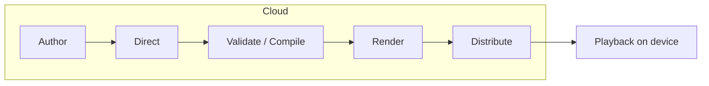

# Improv — Design Sketch

A canned, cloud-authored story performed on small ESP32 stick devices (Game Boy / Tamagotchi visual register), using Resident for the on-device sandbox and Courier for connectivity. This is a brainstorm-stage design doc, not a spec. The goal is to lock the **data model** and the **big-picture pipeline** so they survive contact with later features (layered roles, sfx, interaction, multi-device) without a rewrite.

Companion files: `improv-troupe.md` (the casting catalog — the six actors + Miss Moon) and `improv-storyboard.md` (a worked story cast two ways).

## Glossary

- **Performance**: the compiled, pushable artifact for one story: `cast` + `assets` + `timeline`.
- **Beat**: one atom of the timeline: which role is on screen, its expression, the line + pre-rendered audio, sfx, duration, animation, target device.
- **Actor**: one of the six fixed troupe bodies: `bruno`, `milo`, `ada`, `rosa` (four humans), `pip`, `tuk` (two animals).
- **Role**: a character in a *specific* story ("the dragon"). Resolved to an actor + layers.
- **CastMember**: the binding that resolves a role → actor + layers + voice.
- **Layers**: the paper-doll stack composited on-device, back to front: `back_prop · base · costume · expression · headwear · front_prop`.
- **Miss Moon**: the permanent MC/host. A seventh character (`miss_moon`), never one of the six actors, never cast in a role. Extended expression set; gets sleepy late at night as a bedtime cue.
- **Troupe**: the six actors plus Miss Moon.
- **Expression**: a face overlay (base six: neutral, happy, sad, surprised, angry, scared; Miss Moon has more).

---

## Design principles (locked)

1. **Casting, not rendering.** The cloud never generates pixels for the tiny screen. It casts the story onto a *fixed troupe of pre-made actors* and assembles each role from pre-made layers (expression, and later costume/props), then decides which actor + layers + expression shows when. An impossible rendering problem becomes a tractable mapping problem.
2. **The timeline is the product.** Everything compiles down to an ordered list of **beats**. The cloud produces it; the device consumes it. Get this right and every other piece is swappable — and it already proved that: switching from a fixed character cast to an actors-plus-layers troupe changed the `cast` and the compositor, and left the beat untouched.
3. **The device composites, it doesn't think.** The Lua app resolves a beat's role to an actor + layers, blits a handful of layers back-to-front, plays audio, holds. No story logic on-device. (The one sanctioned exception is Miss Moon's late-night bedtime check in v2 — see the troupe file.)
4. **Canned first.** v1 generates a whole performance up front, pre-renders all audio, pushes it, then plays. No live streaming, no interaction yet.
5. **Additive evolution.** Layered costumes/props, sfx, interaction, and multi-device are all *fields the model already carries*, dark in v1 and lit up later — not new architecture.

---

## Core data model

One compiled artifact gets pushed to the device(s): a **Performance**. It bundles the cast, an asset manifest, and the timeline.

```jsonc
// Performance — the canned, pushable artifact
{
  "schema_version": 2,
  "id": "perf_8f2a",
  "title": "The Knight and the Lonely Dragon",

  "cast": [ /* CastMember[] */ ],      // Miss Moon (always) + the actors this story uses
  "assets": { /* AssetManifest */ },
  "timeline": [ /* Beat[] */ ],

  "stage": {                            // device layout — single device for now
    "devices": ["d1"],
    "default_device": "d1"
  }
}
```

### CastMember — role → actor → layers → voice

The key idea of the troupe model: a **role** ("the dragon") is not an asset. It resolves to a troupe **actor** (`tuk`) plus a **layer set** (horns). The **voice** comes with the actor — each actor has one signature voice, constant across every story, so casting fixes the sound as well as the silhouette. Role and layers are the concerns the director sets per story; the actor carries the voice.

```jsonc
{
  "character_id": "dragon",         // per-story ROLE id — this is what beats reference
  "display_name": "the dragon",
  "actor": "tuk",                   // which of the six actors (or "miss_moon") plays it
  "voice": "tts_low_rumble",        // tuk's signature voice; the render stage reads it
  "layers": {                       // v2 role layers; all null in Phase 1 (base + expression only)
    "costume": null,
    "headwear": "horns",
    "front_prop": null,
    "back_prop": null
  },
  "default_expression": "neutral"
}
```

**Miss Moon is a constant cast member.** Every performance's cast includes the host with the reserved id `miss_moon` (`actor: "miss_moon"`, no layers, her own dedicated voice and extended expression set). The six actors are cast *per story*; Miss Moon is always seated. She is the through-line the child recognises across every story. Full spec in `improv-troupe.md`.

**Casting constraint — one actor, one role.** An actor holds **at most one** role in a story. A story needing more characters of a kind than the troupe has actors is restructured first, and only then are roles merged or cut. Miss Moon sits outside the count, holding her own reserved role and no other. This caps a performance at **six story roles plus the host**. Validate enforces it (`ACTOR_DOUBLED`).

*History, because this rule has moved once and may again.* The Phase 1 rule was at most one role per actor, on the stated grounds that without costume or props two roles on the same actor were the identical picture; it said in the same breath that it would lift once layers made a doubled actor legible. Layers arrived, and on **2026-09-01** the rule was lifted and replaced by *doubling must be legible* — a doubled actor's roles differing in at least one layer slot. That lift was **retracted on 2026-09-18** (user decision, marked "for now") and one-actor-one-role reinstated. The retraction was made with the lift's own condition already met, so it is a change of mind and not a correction. The half layers never solved is the reason it is worth recording: voice is actor-bound, so a dressed-apart double still *sounds* like one character, and per-role voice **modulation** — the same signature voice shifted for the part — does not exist.

### AssetManifest — the troupe (baked) + the story's audio (fetched)

```jsonc
{
  // TROUPE ASSETS — fixed, finite, baked to device flash in v1.
  // uri scheme stays abstract ("flash://" now, "https://" later) so fetch is a distribution change.
  "actors": [
    { "id": "tuk", "base_uri": "flash://actors/tuk/base",
      "expressions": {
        "neutral": "flash://actors/tuk/expr/neutral",
        "angry":   "flash://actors/tuk/expr/angry"   /* ...the shared expression set... */
      } }
    // milo, rosa, bruno, ada, pip, and miss_moon (with her extended expression set) ...
  ],
  "layers": [   // shared library, v2. One sword fits every human — authored once.
    { "id": "sword", "slot": "front_prop", "uri": "flash://layers/front_prop/sword" },
    { "id": "horns", "slot": "headwear",  "uri": "flash://layers/headwear/horns" }
    // ...
  ],

  // STORY AUDIO — per-story, pre-rendered in the cloud, FETCHED at runtime into PSRAM.
  "audio": [
    { "id": "aud_005", "kind": "line", "uri": "https://cdn/.../005.wav",
      "format": "wav", "duration_ms": 3000 },
    { "id": "sfx_roar", "kind": "sfx", "uri": "https://cdn/.../roar.wav",
      "format": "wav", "duration_ms": 900 }
  ]
}
```

Because the troupe and layer library are fixed and finite, they bake to flash and only **audio** is fetched per story. That keeps the flaky network work off the playback path.

### Beat — the atom of the whole system (unchanged by the troupe move)

```jsonc
{
  "index": 5,
  "character_id": "dragon",        // the ROLE on screen this beat (resolved via cast → actor + layers)
  "expression": "angry",           // face overlay to composite
  "text": "Who dares enter MY mountain?",   // the line (display/subtitle/debug)
  "line_audio": "aud_005",         // ref into assets.audio; null for silent beats
  "sfx": [ { "audio": "sfx_roar", "at_ms": 0 } ],
  "duration_ms": 3000,             // usually = line length + small tail
  "animation": "speak",            // "speak" = mouth-flap while audio plays; "none"; "enter" ...
  "device": "d1"                   // multi-device routing; single device => "d1"
}
```

### Worked example (excerpt)

The cast resolves roles to actors + layers once; the timeline just references roles.

```jsonc
"cast": [
  { "character_id": "miss_moon", "display_name": "Miss Moon", "actor": "miss_moon",
    "voice": "tts_moon_host", "layers": {}, "default_expression": "happy" },
  { "character_id": "knight", "display_name": "Sir Milo", "actor": "milo",
    "voice": "tts_mid_earnest",
    "layers": { "costume": "armor", "headwear": "helmet", "front_prop": "sword", "back_prop": null },
    "default_expression": "neutral" },
  { "character_id": "dragon", "display_name": "the dragon", "actor": "tuk",
    "voice": "tts_low_rumble",
    "layers": { "costume": null, "headwear": "horns", "front_prop": null, "back_prop": null },
    "default_expression": "neutral" }
],

"timeline": [
  { "index": 0, "character_id": "miss_moon", "expression": "delighted",
    "text": "In a green kingdom lived a brave knight named Sir Milo.",
    "line_audio": "aud_000", "sfx": [], "duration_ms": 3200, "animation": "speak" },

  { "index": 1, "character_id": "knight", "expression": "angry",
    "text": "I will bring the princess home!",
    "line_audio": "aud_001", "sfx": [ { "audio": "sfx_shing", "at_ms": 200 } ],
    "duration_ms": 2200, "animation": "speak" },

  { "index": 2, "character_id": "dragon", "expression": "angry",
    "text": "Who dares enter MY mountain?",
    "line_audio": "aud_002", "sfx": [ { "audio": "sfx_roar", "at_ms": 0 } ],
    "duration_ms": 3000, "animation": "speak" }
]
```

In Phase 1 the `layers` objects are empty, so the same timeline renders as bare actors with faces. That's the entire contract; everything below is how it gets produced and consumed.

---

## The device-side view

The Lua app resolves each beat's role and composites its layers back-to-front:

```
for each beat where beat.device == my_device_id:
    role = cast[beat.character_id]              // role -> actor + layers
    draw role.layers.back_prop                  // behind the body        (live)
    draw base[role.actor]                       // the actor
    draw role.layers.costume                    //                        (v2)
    draw expression[role.actor][beat.expression]
    draw role.layers.headwear                   //                        (live)
    draw role.layers.front_prop                 // topmost, held item     (live)
    if beat.animation == "speak": mouth-flap the expression overlay
    play line_audio (if any) + schedule sfx at their offsets
    hold for beat.duration_ms
```

For a role that wears nothing every layer draw is a no-op, so it collapses to base + expression; a dressed role adds one blit per worn slot. It's a handful of masked blits with no story logic — still dumb, just layered. Like expression overlays, layer art can declare its own resolution — a `density` in the item's sidecar — and draws at `scale / density` for finer detail without changing the actor's on-screen size.

---

## Pipeline



### 1. Author
- **In:** kid speech (→ STT), typed text, or "surprise me" (LLM writes from a theme).
- **Out:** short story prose + title.
- **Notes:** aim for **60 seconds, within 45–70 — roughly 13–20 beats**, under a hard **80-second ceiling** that the validator enforces in bytes, because it is set by what the device's flash partition holds at the delivery audio format. The arithmetic and its provenance live in the cloud pipeline spec ("Audio format and the story budget"); this line follows it and does not keep its own copy of the numbers. This is a children's product, so the author (especially the "surprise me" LLM path and any kid-typed/spoken input) needs age-appropriate content constraints baked in — wholesome themes, no scary-beyond-fun content. Cheapest to enforce here at the source.

### 2. Direct (the interesting stage)
- **In:** story prose **+ the troupe catalog**: the six actors and their affinities, the shared expression set, the layer vocabulary (costume/headwear/props), voices, and sfx — plus Miss Moon as the fixed host.
- **Out:** the `cast` (each role resolved to an actor + layer set; the actor carries its signature voice) **and** the `timeline` (casting each line to a role, choosing an expression per beat, placing sfx, tagging animation), always framed by Miss Moon.
- **Notes:** the catalog constraint is what makes this work — the director *casts onto existing actors and layers*, it never invents assets. It must cast each actor at most once (the casting constraint above) and should **prefer restructuring the story over demanding an actor the troupe lacks** (e.g. the dragon flies everyone home instead of a horse). This is an LLM task with structured JSON output; expression and sfx placement is where charm lives and where the LLM will be inconsistent — fine, the next stage catches breakage.

### 3. Validate / Compile
- Cheap, deterministic pass over Direct's output. Checks: every `character_id` resolves to a real cast member; every `expression` exists for that actor; every layer id exists in its slot; every `sfx` ref resolves against the baked catalog; no actor holds two roles. (`line_audio` refs are produced downstream by Render, so they're verified after that stage, not here.)
- **Failure behaviour — severities mapped by condition.** *This is the design for the cloud pipeline, which was never built. In this prototype `tools/validate.ts` repairs nothing: it reports 23 codes, 21 at error level and 2 at warning, and a story with an error does not build.* These are not interchangeable; keep them distinct. A downstream inspection tool reconstructs each repair by re-deriving exactly these rules.
  - **snap** — replace with the one legal value: an expression outside the actor's set → the role's `default_expression`; a voice that isn't the actor's signature → the signature (it is derivable, so no model is needed to guess it); a `device` outside `stage.devices` → `default_device`; `animation: "speak"` with no line → `"none"`. Local, safe, in-place.
  - **drop** — bad layer id, a layer that doesn't fit its wearer, or a bad/out-of-range `sfx` ref → remove that element from the beat. Local, in-place. Sfx cued out of order are sorted and non-contiguous beat indices renumbered, which is arithmetic rather than judgement.
  - **bounce** — a structural error Validate can't repair locally → send it back to Direct for another pass. **The whole story bounces, not the beat.** Most of this class is *cast*-shaped (an unknown actor, a doubled actor whose two roles are dressed identically, a duplicated or missing `character_id`, Miss Moon miscast), and a cast error cannot be fixed by re-asking for one beat: recasting a role changes every beat referencing it. A beat-scoped Director is a second stage contract, deferred until the repair record shows it earning its keep.
  - **reject** — still invalid after the bounce → terminal, and the Performance fails. Surface it rather than ship a story with a hole in it.
  - **Every repair is recorded** — rule, path, before, after. A silent repair reads as "the validator fixed it" when it also means "Direct got it wrong and nobody counted"; the record is what keeps those apart.
- Prevents device-side surprises. Keep this stage separate from the LLM so failures stay deterministic and legible.

### 4. Render
- **In:** validated timeline + each cast member's actor-signature voice.
- **Out:** one pre-rendered audio file per line (in that character's voice), resolved sfx assets, and the **actual** `duration_ms` measured from each clip written back into the beats.
- **Notes:** distinct actor voices are the single biggest delight lever and nearly free here — a rumbly dragon (Tuk), a squeaky sidekick (Pip). Each actor has one signature voice, so casting for contrast casts the sound too. **Miss Moon uses one dedicated host voice, consistent across every story** — the audible half of the through-line.

### 5. Distribute
- Finalize the Performance JSON + manifest. The troupe and layer library are already in flash, so the device fetches the story's **Performance and its audio** — the timeline as data to a resident generic player, the clips into PSRAM up front — then plays entirely locally. Decouples the flaky network part from playback. (In this prototype each story still ships as its own compiled Lua app, delivered alongside its audio; the generic resident player is the design for the cloud.)
- For clients that are not the device, the same bundle is served plus a **video rendering** of the performance, produced by running the device app itself. `npm run export:video` already does this locally; the rule that matters here is that the video is a rendering and the Performance remains the contract.

### 6. Playback
- The composite loop above. For multi-device later: a director broadcasts a synchronized start + shared timeline; each device filters beats by its own `device` id. Courier's UDP multicast keeps them in sync locally even if the internet drops.

---

## Where the delight comes from (ranked by delight ÷ effort)

1. **Distinct actor TTS voices.** Each actor's signature voice, free in the render stage, lands instantly with kids.
2. **Miss Moon as host, and her bedtime magic.** A recognisable friend who opens and closes every story — and gets sleepy only late at night, a bedtime cue aimed at parents that feels like magic, not nagging. Authored once, pays off forever.
3. **Sound effects.** Tiny files, huge fun — roar, sword-shing, sparkle, neigh. Model supports offset-timed sfx per beat.
4. **Mouth-flap while speaking.** Two-frame overlay swap driven by `animation: "speak"`. Cheap, makes a character feel alive.
5. **Expressions (Phase 1 core).** Pre-drawn face overlays composited per beat — a lookup, not a render. Miss Moon's phase-as-mood is a bonus channel only she has.
6. **A title-card beat + a little idle bob.** Small polish, big "this is a real toy" feeling.

Almost none of the delight is in screen resolution. It's in voice, character, sound, and timing. The screen just needs to be *charming and legible*, which the Game Boy register nails.

---

## Roadmap, and how the model absorbs each step

| Stage | New capability | What changes in the data model |
|---|---|---|
| **v1** | Single device, canned. Miss Moon + troupe. **base + expression**, mouth-flap, sfx — **and layers, which arrived early.** | Base schema; `cast.layers` **populated** (the plan below held until the layer catalog and compositor shipped inside v1; committed fixtures dress their casts, and the cloud Director casts layers as part of casting) |
| **v2** | **Layered roles** (costume / headwear / props), Miss Moon's moon-phase, device-reactive bedtime | `cast.layers` populated; compositor draws the layer slots |
| **v3** | Interaction: branch points, kid picks what happens, kid as a character | Add `choices` / branch edges between beats; a `player` cast member |
| **v4** | Multi-device ensemble: a device per character + Miss Moon | Already present: `device` per beat + `stage.devices`; add a sync/clock protocol |

The beat contract is unchanged across all four rows. The big pivot already survived — going from a fixed character cast to actors-plus-layers landed entirely in `cast` and the compositor, not the beat. That's the additive principle doing its job.

---

## Open decisions (as left at the end of prototype 1)

1. **Troupe storage — baked vs fetched.** Baking the troupe (actor bases + expression overlays + shared layer library) to flash is simplest and fastest for v1, but new actors/layers require a reflash. Fetching over the network is more flexible but adds decode/storage work on-device. Recommendation: **bake for v1**, keep the manifest's `uri` scheme abstract so switching is a distribution-stage change, not a model change.
2. ~~**Audio format — WAV vs compressed.**~~ **Decided (2026-09-01):** WAV, and the size question that would have forced compression was answered by sample rate instead. Delivery is **16 kHz mono 16-bit PCM WAV**, which the device already accepts unchanged — it reads the header as-is and resamples per clip — so no decoder, no CPU cost, and no new firmware. Compression stays available as the next lever if a longer story ever needs one, but it buys length, not much else, and would cost a decoder in `AudioDriver` plus every host tool that reads a bundle. The format is pinned in `tools/lib/delivery-format.ts`.
3. **Timing model — audio-driven vs fixed.** Deriving `duration_ms` from the actual rendered clip keeps narration and playback aligned and is what the Render stage assumes. Fixed authored durations are simpler but drift. Recommendation: **audio-driven**.
4. **Bedtime — generation-time vs playback-time.** Static (cloud stamps a "late one") is simplest but a story made at noon and replayed at night won't know; device-reactive (checks the clock live) is more magical but is the one place the device runs real logic. Recommendation: **static for v1, device-reactive for v2.** Details in the troupe file.
5. **Scene / background.** v1 shows exactly one composited character per beat and cuts between them — no backgrounds, no two-characters-on-screen. A real constraint of a 135×240 screen. Confirm you're happy cutting rather than composing, and deferring any `scene`/background concept.
6. **Multi-character beats.** Dialogue works fine as alternating single-character beats. A true two-hander (knight *and* dragon visible at once) is out for v1; it fits naturally into v4 where each character is a separate device anyway.
7. ~~**Validate reject handling.**~~ **Decided (2026-09-01), as recommended:** a bounce budget of **one**, then **fail the whole Performance** — nothing ships and the story is regenerated, rather than dropping a beat and leaving a narrative gap. Regenerating is cheap at this scale; shipping an incoherent story isn't worth it. Revisit if regeneration cost ever bites.

*(The Phase 1 one-role-per-actor rule lifted on 2026-09-01 and was **reinstated on 2026-09-18** — see the casting constraint above for both moves and why. One actor, one role; enforced in Direct/Validate.)*

---

## One-line summary

The cloud casts a story onto a fixed troupe of actors, assembles each role from pre-made layers, and compiles a beat timeline with pre-rendered per-role audio — all hosted by Miss Moon; the stick resolves each beat to an actor, composites a few layers, and plays the clip. Everything delightful (voices, the host, sfx, expressions, layered costumes, and eventually a device-per-character ensemble) is already a field in the model — dark now, lit later.
